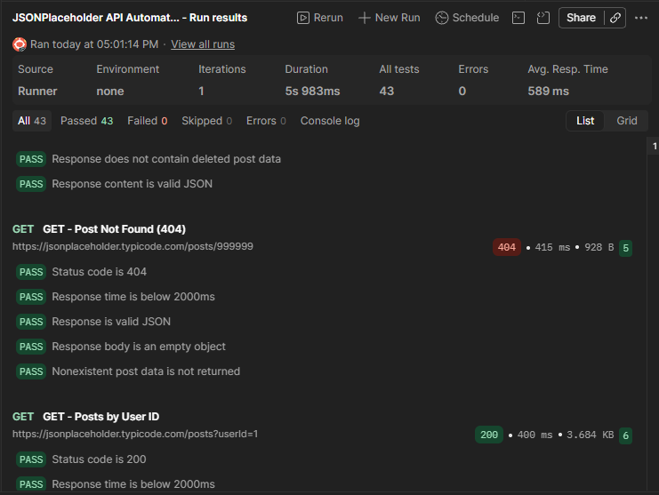

# Postman REST API Automation Testing

A REST API testing project built using **Postman and JavaScript** to validate API functionality, HTTP responses, JSON data structures, and negative test scenarios.

This project demonstrates hands-on experience in API test design, automated assertions, functional testing, and test execution using the JSONPlaceholder public REST API.

## Test Execution Results

| Metric | Result |
|---|---|
| Total API Requests | 8 |
| Automated Tests | 43 |
| Passed | 43 |
| Failed | 0 |
| Success Rate | 100% |
| Average Response Time | 589 ms |
| Total Execution Duration | 5.983 seconds |

### Test Execution Evidence



## Tools and Technologies

- **Postman** — API request management, automated testing, and collection execution
- **JavaScript** — Automated test scripts and assertions
- **REST API** — HTTP request and response testing
- **JSON** — Request payloads and response validation
- **GitHub** — Version control and project documentation

## API Test Coverage

The project uses [JSONPlaceholder](https://jsonplaceholder.typicode.com/), a free public REST API for testing and prototyping.

| Test Case | HTTP Method | Expected Status |
|---|---|---|
| Retrieve All Posts | GET | 200 OK |
| Retrieve Single Post | GET | 200 OK |
| Create New Post | POST | 201 Created |
| Update Existing Post | PUT | 200 OK |
| Partially Update Post Title | PATCH | 200 OK |
| Delete Existing Post | DELETE | 200 OK |
| Retrieve Nonexistent Post | GET | 404 Not Found |
| Filter Posts by User ID | GET | 200 OK |

## Automated Test Validations

The collection includes JavaScript assertions covering:

- HTTP status code validation
- Response time validation
- JSON response structure and data types
- Required response fields
- Response body content verification
- POST request and response data matching
- PUT and PATCH update response validation
- DELETE response validation
- Negative testing using HTTP 404
- Query parameter filtering validation

**Note:** JSONPlaceholder simulates POST, PUT, PATCH, and DELETE operations without permanently modifying server data. Tests validate the returned responses rather than persistent database changes.

## How to Run the Tests

1. Install [Postman](https://www.postman.com/downloads/).
2. Download `JSONPlaceholder-API-Tests.postman_collection.json` from this repository.
3. Open Postman and click **Import**.
4. Select the downloaded JSON collection.
5. Open the imported collection and select **Run**.
6. Choose all 8 requests.
7. Set iterations to **1**.
8. Select **Functional** and run the collection.
9. Review the automated test results.

## Project Structure

```text
postman-api-automation-testing/
├── JSONPlaceholder-API-Tests.postman_collection.json
├── postman-collection-test-results.png
├── postman-cli-testresults.png
└── README.md
```

## Key Learning Outcomes

- Designed and executed API test cases across five HTTP methods.
- Developed automated JavaScript assertions in Postman.
- Performed positive and negative API testing.
- Validated response status codes, JSON structures, and returned data.
- Executed a complete API testing collection and documented results.
- Published reusable API testing resources and execution evidence on GitHub.

## Author

**pausetine**

QA Automation and API Testing Portfolio Project

**Project Status:** Completed — 43/43 automated tests passed during the documented collection run.
